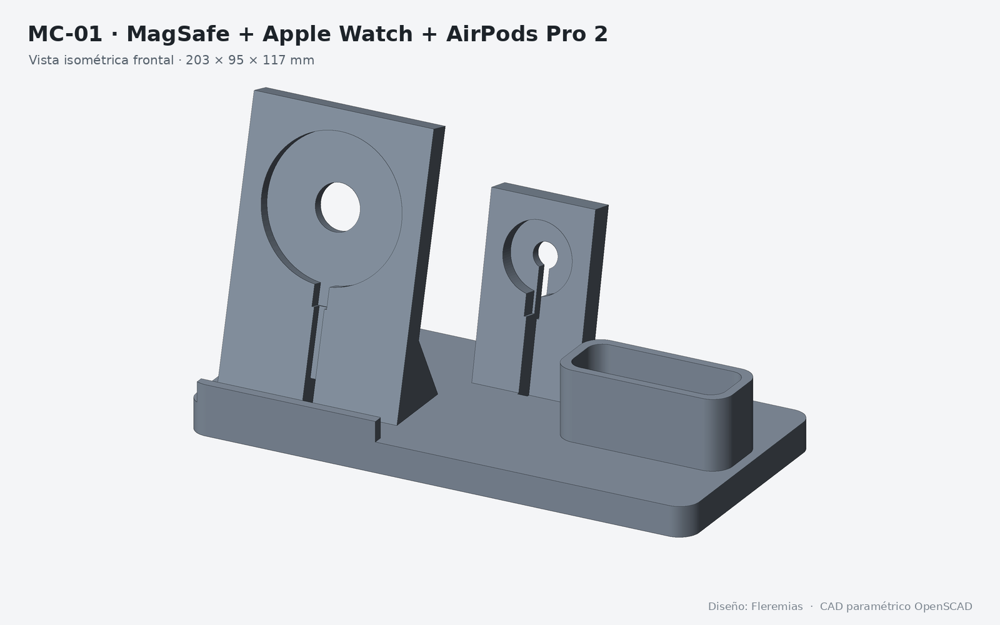
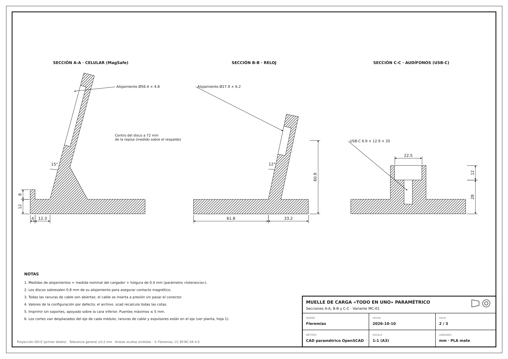
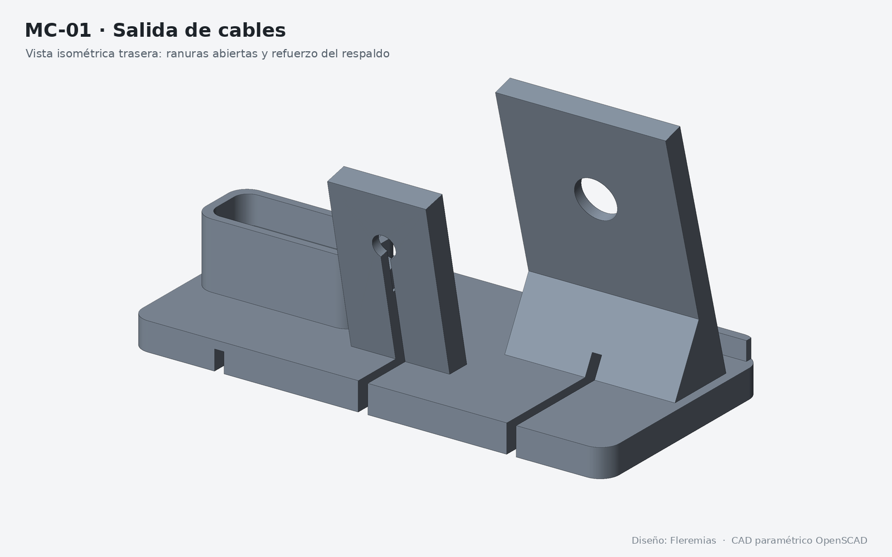
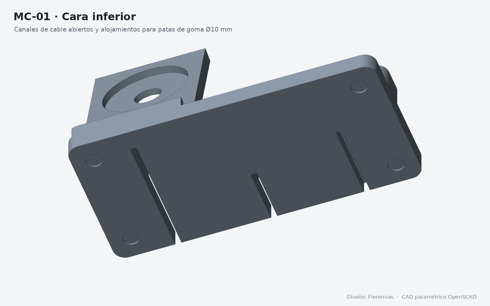
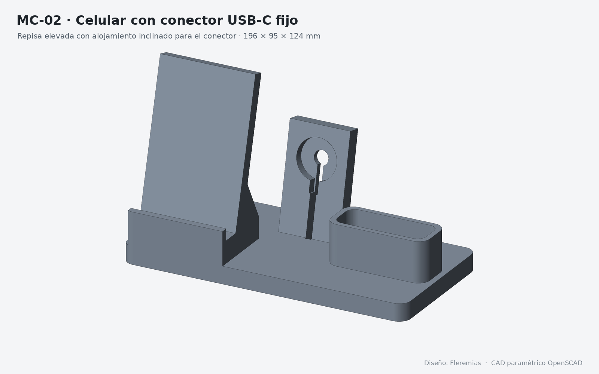
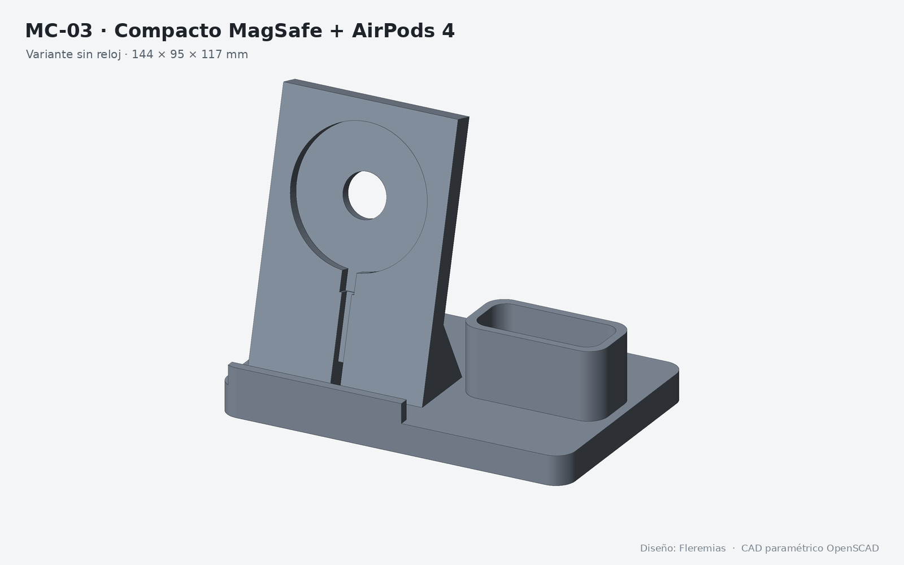
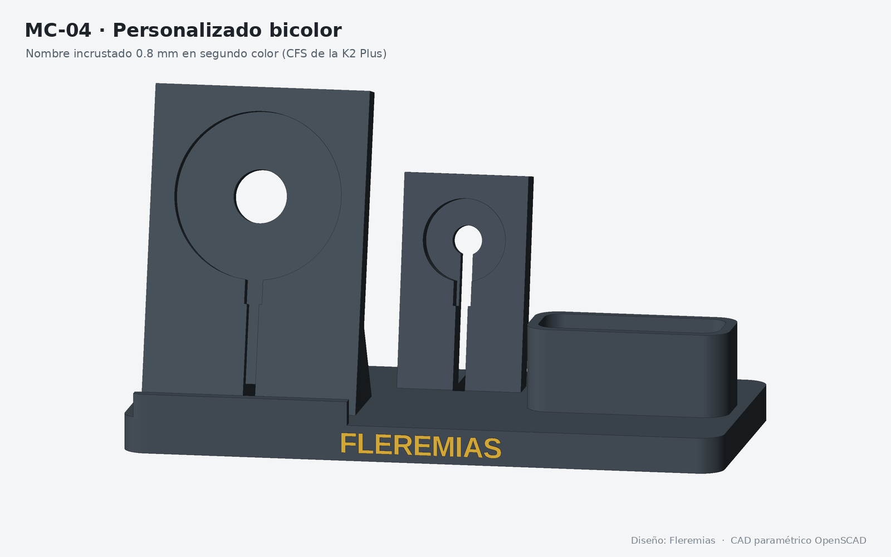
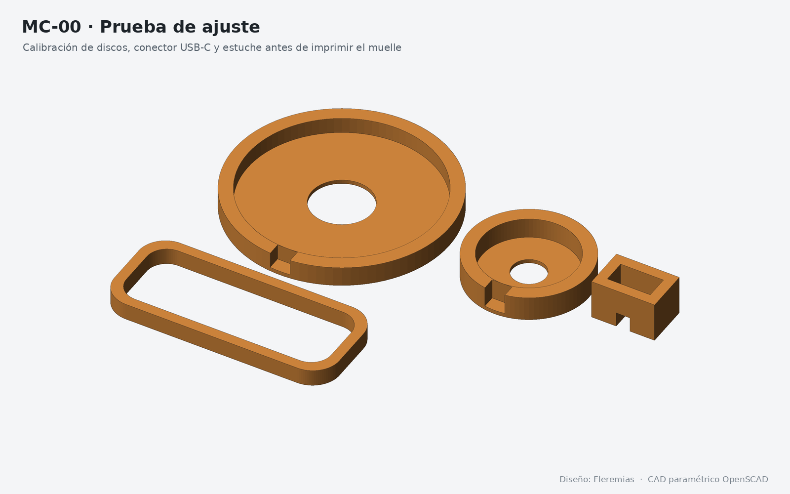
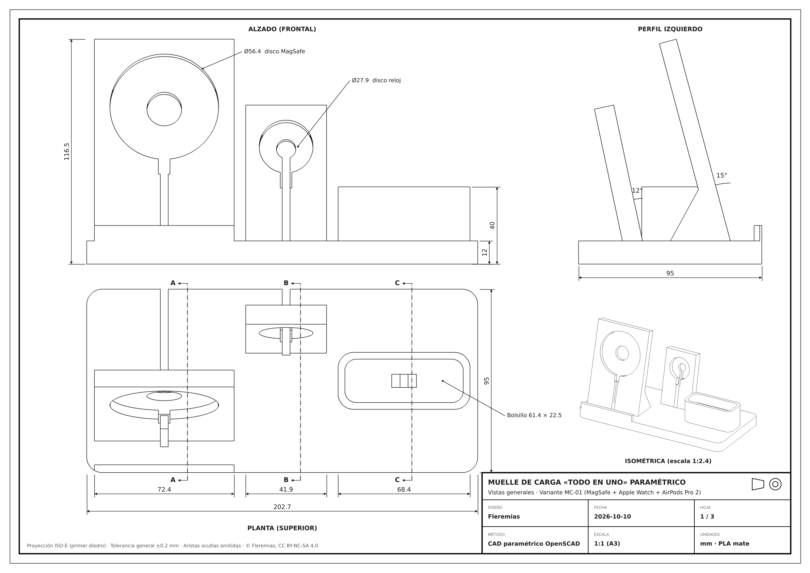

# Muelle de carga «todo en uno» paramétrico

**Diseño original de Fleremias** · CAD paramétrico en OpenSCAD · Versión 1.0 · 2026-10-10

Base de escritorio para **celular, reloj y audífonos** que se genera a la medida de los tres dispositivos de cada cliente. Usa los **cargadores originales** (disco MagSafe/Qi2, disco del reloj y cable USB-C). La base los aloja y ordena los cables, que salen todos por la parte trasera.

| | |
|---|---|
| Método | CAD paramétrico por código (OpenSCAD, geometría sólida constructiva) |
| Configurador | Customizer de OpenSCAD y de MakerWorld (Parametric Model) |
| Tamaño por defecto | 203 × 95 × 117 mm (MC-01) |
| Material | PLA mate, una o dos piezas de color |
| Impresión | Sin soportes, capa 0.2 mm, boquilla 0.4 mm |
| Impresoras probadas | Creality K2 Plus Combo (CFS multicolor) · SPARKX i7 |
| Laminador | Creality Print |
| Licencia | [CC BY-NC-SA 4.0](LICENSE) |

## El problema y la idea

Cada persona tiene una combinación distinta de celular, reloj y audífonos, así que un muelle genérico casi nunca encaja. Este modelo es un **configurador**: se eligen los tres dispositivos y sus cargadores en el Customizer, y el código genera la base con los huecos exactos. Es un producto pensado para venderse **por pedido**.

## Estructura del repositorio

| Carpeta | Contenido |
|---|---|
| [`01_codigo_cad/`](01_codigo_cad/) | `muelle_carga_todo_en_uno.scad`, el modelo paramétrico completo (sin librerías externas) |
| [`02_modelos_stl/`](02_modelos_stl/) | Configuraciones de muestra listas para imprimir (GitHub las muestra en 3D al abrirlas) |
| [`03_planos/`](03_planos/) | Planos técnicos A3: vistas generales, secciones y tabla de parámetros (PDF de 3 hojas y PNG) |
| [`04_renders/`](04_renders/) | Muestras R-01 a R-07 |
| [`05_documentacion/`](05_documentacion/) | [Guía de pedidos e impresión](05_documentacion/GUIA_DE_PEDIDOS_E_IMPRESION.md) |

### Modelos de muestra

| Código | Configuración | Medidas (mm) |
|---|---|---|
| MC-00 | Prueba de ajuste (huecos de discos y conector para calibrar la tolerancia) | 131 × 100 × 12 |
| MC-01 | MagSafe + Apple Watch + AirPods Pro 2 | 202.7 × 95 × 116.5 |
| MC-02 | Celular con USB-C fijo + Apple Watch + AirPods Pro 2 | 196.3 × 95 × 123.9 |
| MC-03 | Compacto: MagSafe + AirPods 4, sin reloj | 144.3 × 95 × 116.5 |
| MC-04 | Personalizado bicolor: cuerpo + nombre en un segundo color | — |

Todas las mallas están cerradas (*watertight*) y verificadas.

## Arquitectura del modelo

El código está organizado en módulos independientes que se suman y restan sobre una base común:

- `celular_pos()` / `celular_neg()`: respaldo inclinado con hueco para el disco MagSafe/Qi2 o alojamiento inclinado para un conector USB-C fijo.
- `reloj_pos()` / `reloj_neg()`: torre inclinada con hueco para el disco del reloj y espacio para la correa.
- `audif_pos()` / `audif_neg()`: bolsillo a la medida del estuche, con conector USB-C fijo o sin cable.
- `cuerpo()`: une la base con los módulos activos, abre los canales de cable hacia atrás y los huecos de las patas.
- `texto_sol()`: nombre en relieve en la cara frontal, exportable como pieza aparte para un segundo color.
- `prueba()`: pieza corta para comprobar el ajuste antes de imprimir el muelle completo.

La distribución en fila (celular, reloj, audífonos) se recalcula sola cuando un módulo se desactiva. En modo USB-C el labio frontal se engrosa automáticamente para que la pared nunca baje de 3 mm.

### Parámetros principales (pestañas del Customizer)

| Pestaña | Parámetros |
|---|---|
| Celular | Modo (MagSafe/Qi2, cable USB-C o ninguno), modelo (iPhone 15/16, Pro Max, Galaxy S24/S25, Ultra, Pixel 8/9 o personalizado), funda, ángulo del respaldo (15°), diámetro/grosor del disco (56 × 5.6) y altura del centro |
| Reloj | Disco Apple Watch o personalizado, altura del centro (50 mm) y ángulo (12°) |
| Audífonos | Cable USB-C o solo bolsillo, AirPods Pro 2 / AirPods 4 / huella personalizada, posición del puerto y profundidad |
| Cables y USB-C | Diámetro del cable, bota, cuerpo del conector (12.5 × 6.5 × 20), espacio de curva, cuánto sobresale el disco |
| Base | Fondo y alto (95 × 12), radio de esquinas, separación entre módulos, patas de goma y texto frontal |
| Exportar | `pieza`: todo · solo cuerpo · solo texto · prueba de ajuste; `tolerancia` (0.4 mm) |

Las medidas de los presets de Apple Watch y MagSafe son aproximadas: siempre hay que medir los cargadores reales con calibrador e imprimir la prueba de ajuste.

## Cómo usarlo

1. Abre `01_codigo_cad/muelle_carga_todo_en_uno.scad` en [OpenSCAD](https://openscad.org/) (2021.01 o posterior) y activa *Ventana → Customizer*.
2. Elige los dispositivos del cliente en cada pestaña y ajusta las medidas.
3. Exporta `pieza = Prueba de ajuste`, imprímela y corrige `tolerancia` si los discos quedan duros o sueltos.
4. Exporta el muelle completo con F6 y luego *Archivo → Exportar → STL*.
5. Para el nombre en otro color, exporta `Solo cuerpo` y `Solo texto`, impórtalos juntos en Creality Print como una pieza de varias partes y asigna un filamento a cada una.

Ajustes de impresión completos y flujo de pedido: [guía de pedidos e impresión](05_documentacion/GUIA_DE_PEDIDOS_E_IMPRESION.md).

## Galería

| | |
|---|---|
|  |  |
|  |  |
|  |  |

## Autoría y licencia

Diseño, modelado CAD y documentación: **Fleremias** ([@fleremiasflemin20-maker](https://github.com/fleremiasflemin20-maker)).
También disponible en la [Biblioteca 3D](https://github.com/fleremiasflemin20-maker/biblioteca-3d).

Publicado bajo [Creative Commons Atribución-NoComercial-CompartirIgual 4.0](LICENSE). Puedes imprimirlo y modificarlo para uso personal citando al autor. La venta de piezas impresas o de versiones derivadas requiere permiso de Fleremias.
